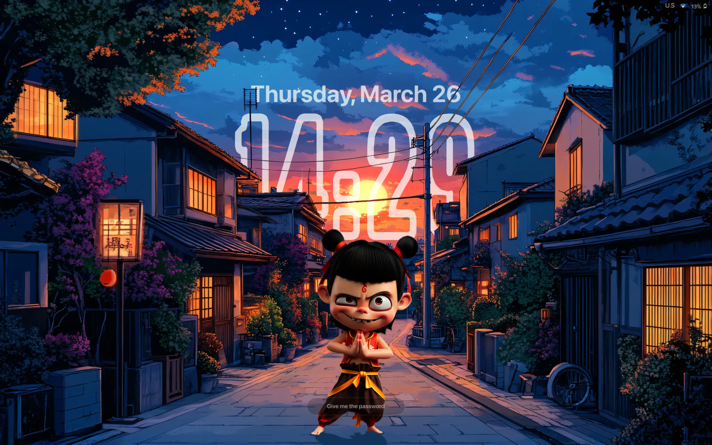

# neZha — Hyprlock Theme

A minimal, visually layered lock screen theme for [Hyprlock](https://github.com/hyprwulf/hyprlock), designed to pair with the [neZha SDDM Theme](https://github.com/tuklu/neZha-SDDM-Theme).



```sh
curl -fsSL https://raw.githubusercontent.com/tuklu/neZha-Hyprlock-Theme/main/install.sh | bash
```

---

## Assets notice

The theme assets (`backgrounds/`, `foreground/`) total ~40 MB and are not in git. They ship as `assets.tar.xz` on the release, which the install script downloads.

---

## Features

- Large typographic clock (Steelfish Outline)
- Day / month / date label
- Foreground image overlay for depth
- Password input field with custom placeholder
- Top-right system status bar: keyboard layout · network · volume · battery
- All colors in one file, `colors.conf`

---

## Dependencies

| Tool | Purpose |
|------|---------|
| [hyprlock](https://github.com/hyprwulf/hyprlock) | Lock screen daemon |
| [hyprctl](https://wiki.hyprland.org/Hypr-Ecosystem/hyprctl/) | Keyboard layout detection |
| [iwctl](https://iwd.wiki.kernel.org/) | Wi-Fi status |
| [pamixer](https://github.com/cdemoulins/pamixer) | Volume status |
| Steelfish Outline font | Clock typeface |
| SF Pro Display Bold font | UI labels |
| Nerd Fonts | Status bar icons |

---

## Installation

### Recommended — install script (downloads from release)

```sh
curl -fsSL https://raw.githubusercontent.com/tuklu/neZha-Hyprlock-Theme/main/install.sh | bash
```

This will:
- Download and extract the latest `assets.tar.xz` and `source.tar.xz` from the GitHub release
- Install everything under `~/.config/hypr/neZha-Hyprlock-Theme/`
- Copy the scripts to `~/.config/hypr/scripts/` and make them executable
- Write `~/.config/hypr/hyprlock.conf` with correct absolute asset paths

### Manual setup

1. Clone the repo, then extract `assets.tar.xz` from the latest release into it:
   ```sh
   git clone https://github.com/tuklu/neZha-Hyprlock-Theme ~/.config/hypr/neZha-Hyprlock-Theme
   ```

2. Copy the scripts and make them executable:
   ```sh
   cp ~/.config/hypr/neZha-Hyprlock-Theme/scripts/*.sh ~/.config/hypr/scripts/
   chmod +x ~/.config/hypr/scripts/*.sh
   ```

3. Write `hyprlock.conf` with absolute asset and color paths:
   ```sh
   THEME=~/.config/hypr/neZha-Hyprlock-Theme
   sed -e "s|\./assets/|$THEME/assets/|g" -e "s|\./colors.conf|$THEME/colors.conf|" \
       "$THEME/hyprlock.conf" > ~/.config/hypr/hyprlock.conf
   ```

---

## Colors

Every color the lock screen uses is a variable in `colors.conf`, sourced on
the first line of `hyprlock.conf`. Restyle by editing that file, or point the
`source` line at a colors file of your own that defines the same variables:
`$color`, `$clock_color`, `$inner_color`, `$outer_color`, `$font_color`,
`$check_color`, `$fail_color`, `$status_color`.

---

## Related

**[neZha SDDM Theme](https://github.com/tuklu/neZha-SDDM-Theme)** — the matching login screen theme for SDDM. Use both for a consistent look from login to lock screen.

---

## License

[MIT](LICENSE) © tuklu
